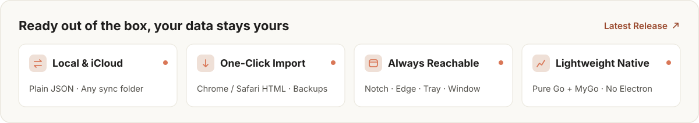
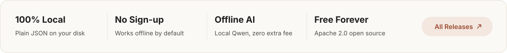

  <a href="README.md">简体中文</a> · <strong>English</strong>

<a href="https://github.com/eachann1024/cooool-mark/releases/latest"><picture><source media="(prefers-color-scheme: dark)" srcset="docs/readme/en/dark/hero.svg"><source media="(prefers-color-scheme: light)" srcset="docs/readme/en/light/hero.svg"></picture></a>

<a href="https://github.com/eachann1024/cooool-mark/releases/latest"><picture><source media="(prefers-color-scheme: dark)" srcset="docs/readme/en/dark/features.svg"><source media="(prefers-color-scheme: light)" srcset="docs/readme/en/light/features.svg"></picture></a>

<a href="https://github.com/eachann1024/cooool-mark/releases/latest"><picture><source media="(prefers-color-scheme: dark)" srcset="docs/readme/en/dark/modes.svg"><source media="(prefers-color-scheme: light)" srcset="docs/readme/en/light/modes.svg"></picture></a>

<a href="https://github.com/eachann1024/cooool-mark/releases"><picture><source media="(prefers-color-scheme: dark)" srcset="docs/readme/en/dark/highlights.svg"><source media="(prefers-color-scheme: light)" srcset="docs/readme/en/light/highlights.svg"></picture></a>

  <a href="https://github.com/eachann1024/cooool-mark/releases/latest">Latest Release</a> ·
  <a href="https://github.com/eachann1024/cooool-mark/releases">All Releases</a> ·
  <a href="https://github.com/eachann1024/cooool-mark/issues">Issues</a> ·
  <a href="LICENSE">Apache 2.0</a>

  Apache License 2.0 © 2026 eachann1024 · When using or modifying this project, keep <a href="NOTICE">NOTICE</a> and credit Cooool Mark / eachann1024 · See <a href="THIRD_PARTY_NOTICES.md">THIRD_PARTY_NOTICES.md</a>

