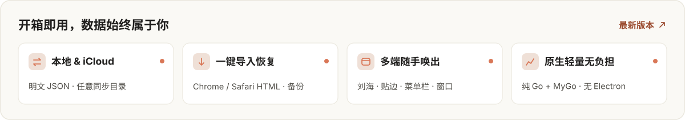
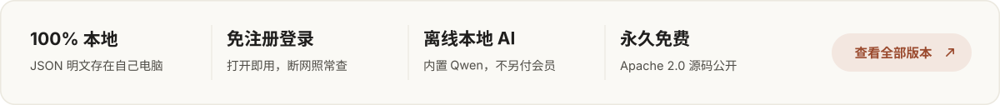

  <strong>简体中文</strong> · <a href="README.en.md">English</a>

<a href="https://github.com/eachann1024/cooool-mark/releases/latest"><picture><source media="(prefers-color-scheme: dark)" srcset="docs/readme/dark/hero.svg"><source media="(prefers-color-scheme: light)" srcset="docs/readme/light/hero.svg"></picture></a>

<a href="https://github.com/eachann1024/cooool-mark/releases/latest"><picture><source media="(prefers-color-scheme: dark)" srcset="docs/readme/dark/features.svg"><source media="(prefers-color-scheme: light)" srcset="docs/readme/light/features.svg"></picture></a>

<a href="https://github.com/eachann1024/cooool-mark/releases/latest"><picture><source media="(prefers-color-scheme: dark)" srcset="docs/readme/dark/modes.svg"><source media="(prefers-color-scheme: light)" srcset="docs/readme/light/modes.svg"></picture></a>

<a href="https://github.com/eachann1024/cooool-mark/releases"><picture><source media="(prefers-color-scheme: dark)" srcset="docs/readme/dark/highlights.svg"><source media="(prefers-color-scheme: light)" srcset="docs/readme/light/highlights.svg"></picture></a>

  <a href="https://github.com/eachann1024/cooool-mark/releases/latest">下载最新版本</a> ·
  <a href="https://github.com/eachann1024/cooool-mark/releases">全部版本</a> ·
  <a href="https://github.com/eachann1024/cooool-mark/issues">问题反馈</a> ·
  <a href="LICENSE">Apache 2.0</a>

  Apache License 2.0 © 2026 eachann1024 · 使用或修改请保留 <a href="NOTICE">NOTICE</a> 并标明来自 Cooool Mark / eachann1024 · 第三方声明见 <a href="THIRD_PARTY_NOTICES.md">THIRD_PARTY_NOTICES.md</a>

